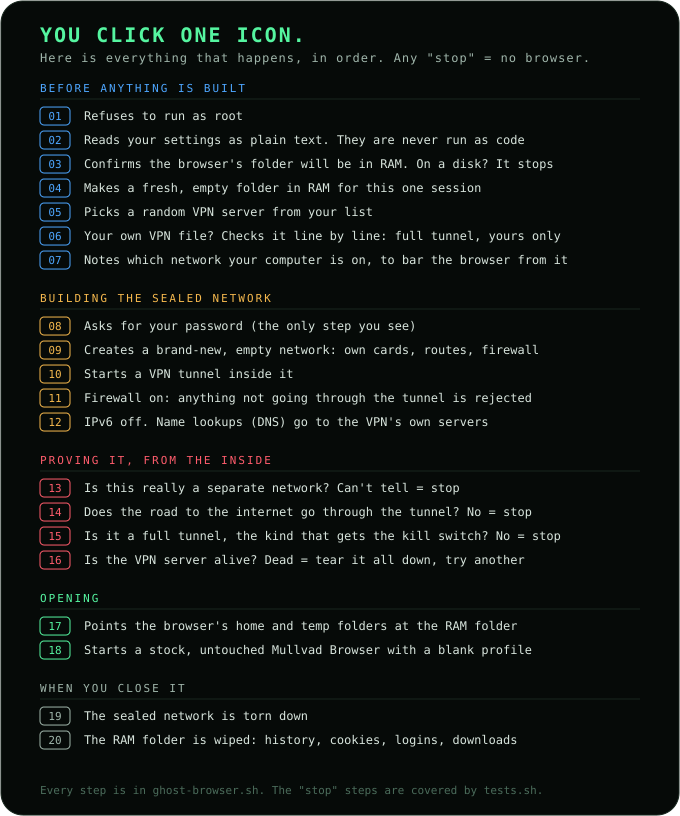
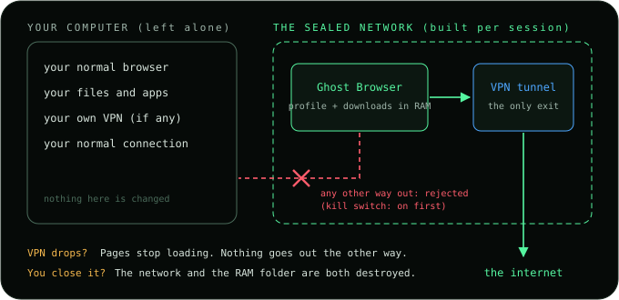
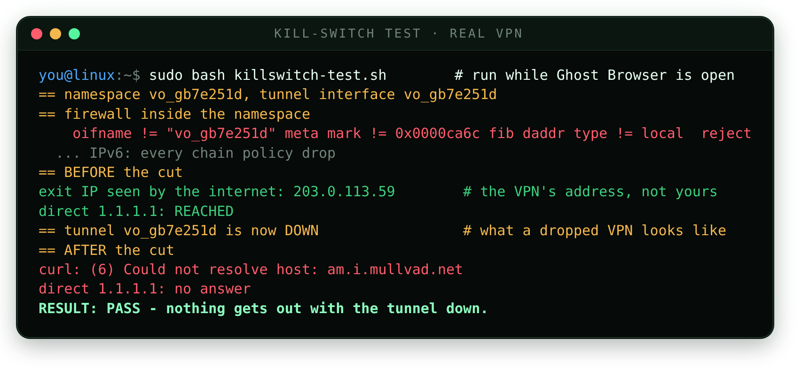
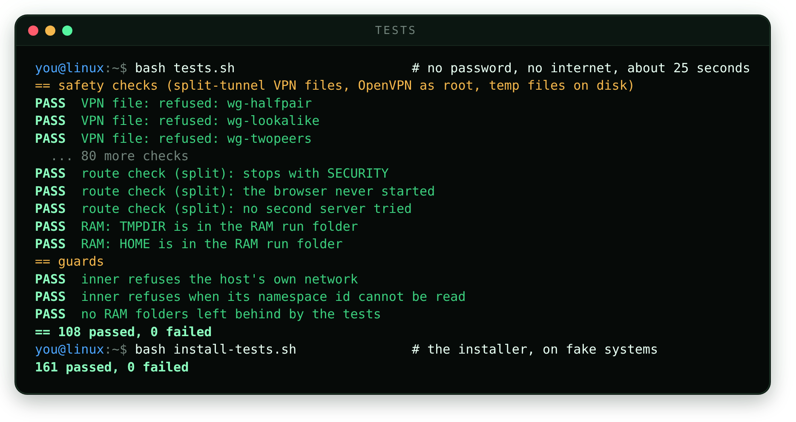
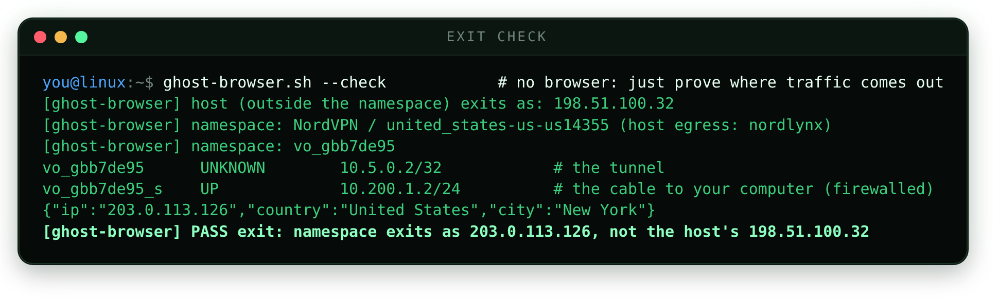

# GHOST BROWSER

<p align="center">
  
</p>

<p align="center">
  <strong>You click one icon. Your computer builds a sealed, VPN-only network, puts a brand-new browser inside it, and keeps all of it in memory.</strong><br>
  Close the window and the network, the browser profile, the history, the logins and the downloads are destroyed.
  Next click, it builds a new one from nothing.
</p>

<p align="center">
  
  
  
  
  
  
</p>

---

## 👻 What it is, in plain English

A private window forgets your history. That's all it does. Websites still see your real address, your downloads stay on the disk, and if you use a VPN and it drops for a second, your browser keeps talking over your normal connection.

Ghost Browser is not a browser setting. It's a small program that, every time you open it, builds a separate place for the browser to live in:

- **Its own network.** Not your computer's network: a new, empty one with its own network cards, its own routes and its own firewall. The only door out of it is a VPN tunnel.
- **Its own blank browser.** A stock [Mullvad Browser](https://mullvad.net/en/browser) with a brand-new profile. No history, no cookies, no saved logins, no extensions of yours.
- **All of it in RAM.** The profile, the temporary files and the downloads are held in memory, not written to your disk.

It's the closest thing to opening a brand-new computer just to browse, then throwing that computer away. Close the window and it's gone. Your normal browser, your files and your own VPN are never touched.

> You don't need to know what a network namespace, a kill switch or WireGuard is. You install it once, pick your VPN, and after that it's an icon you double-click.

---

## ⚙️ One click. Twenty steps.

This is the part nobody sees. From your side: you click, type your password, and a browser opens a few seconds later. In between, the launcher does this, in this order. If any step marked "stop" fails, **no browser opens.**

<p align="center">
  
</p>

Steps 13 to 16 are the ones I care about most. The launcher doesn't trust that the sealed network was built right. It goes **inside** and checks for itself, every single launch, before the browser is allowed to start.

---

## 🔒 The sealed network, and why a dropped VPN can't leak

<p align="center">
  
</p>

Most "kill switches" are a rule added to your normal network after you connect: *if the VPN drops, block traffic.* It has to react in time, and there's a gap between starting your browser and the rule being ready.

Here it's the other way round. The firewall goes up **first**, inside an empty network. Then the tunnel. Then the checks. The browser is the last thing to exist, and it's born inside a network where the tunnel is the only way out. If the VPN dies, pages stop loading. There is no "normal connection" in there to fall back to.

---

## 🧹 What's left after you close it

| | Private window | VPN app + your browser | **Ghost Browser** |
|---|---|---|---|
| History, cookies, logins | gone | kept | **gone** |
| Downloads | kept on disk | kept on disk | **gone** (they were in RAM; move what you want to keep before closing) |
| Sites see your real address | yes | no | **no** |
| VPN drops mid-session | — | depends on the app and its settings | **nothing gets out** |
| What sites can fingerprint | your everyday browser | your everyday browser | a stock Mullvad Browser, the same as every other one |
| Changes to your system | none | system-wide VPN | **none**: it runs beside your own VPN without touching it |

---

## 🧪 Proof, not promises

Anyone can write "no leaks" in a README. Here's what was actually done, and you can run all of it yourself.

**1. The kill switch was cut on purpose, on a real VPN.** With Ghost Browser open, a test script shut the tunnel off and then tried to reach the internet from inside the sealed network.

<p align="center">
  
</p>

**2. 269 automated tests, no password, no internet.** 108 for the launcher and 161 for the installer. They build fake networks that copy the real layout, then feed the launcher bad VPN files, dead servers and half-built tunnels, and check that the browser never starts.

<p align="center">
  
</p>

**3. The exit address is checked from inside.** One command shows where your computer comes out and where Ghost Browser comes out. They must differ.

<p align="center">
  
</p>

<sub>Pictures are real output, trimmed to fit, with real IP addresses swapped for example ones and the grey <code>#</code> notes added. Full output: <a href="docs/PROOF.md">docs/PROOF.md</a>.</sub>

**4. The tests were tested.** A passing test only shows the code does what the test asks. So safety rules were broken on purpose, one at a time (27 in total), to see whether a test noticed. Every one was caught.

**5. It was attacked before you saw it.** The launcher and the installer each went through repeated rounds of independent review, where one reviewer hunts for a hole and a second, sceptical one has to reproduce it before it counts. 150 confirmed findings were fixed, including two critical ones in the installer's first drafts. The details, including the embarrassing ones, are in [docs/PROOF.md](docs/PROOF.md).

Run it yourself:

```bash
bash tests.sh                  # launcher: 108 checks, ~25 s, no sudo, no internet
bash install-tests.sh          # installer: 161 checks on fake systems
ghost-browser.sh --selftest    # builds a real sealed network with a dead tunnel; nothing may get out
ghost-browser.sh --check       # your real VPN: where does the sealed network come out?
sudo bash killswitch-test.sh   # with Ghost Browser open: cut the tunnel, try to get out
```

---

## 🐧 Why Linux only

Because Linux is the only desktop system that can do the main trick.

The sealed network is a **network namespace**, a feature of the Linux kernel. The operating system itself keeps the browser inside it. The browser doesn't have to behave, and no setting inside the browser can open another way out.

Windows and macOS have nothing like it. A version for them would have to rely on the browser obeying a proxy setting: one lock, held by the browser itself. That can be built, and it may be one day, but it would be a weaker promise and it would say so. This version stays Linux-only, because here the promise is kept by the kernel.

---

## 🚀 Install

**You need:**

- Linux Mint, Ubuntu or Debian (64-bit Intel/AMD). Other Linux systems: manual steps only, for now.
- A VPN that gives you WireGuard: NordVPN, Mullvad, IVPN, AirVPN, AzireVPN and Mozilla VPN are downloaded for you. For Proton, PIA, Surfshark, Windscribe or your own server, point it at your WireGuard `.conf` files.
- Your password, once per launch (building a network needs it).

```bash
git clone https://github.com/officialtomblack/GHOST-BROWSER-LINUX.git
cd GHOST-BROWSER-LINUX
bash install.sh --dry-run      # shows every step; changes nothing; no password
bash install.sh
```

The installer:

- installs Mullvad Browser from Mullvad's own repository, after checking Mullvad's signing key **byte for byte** against the published one;
- installs [vopono](https://github.com/jamesmcm/vopono) 1.0.2, after checking the download against a pinned SHA-256;
- adds a **Ghost Browser** entry to your menu and, if you want, your desktop;
- asks which VPN to use, then runs the self-test and the exit check. If either fails it says **NOT ready** instead of "done".

It adds no services, no sudo rules and no firewall rules to your system, and never overwrites your config. `bash install.sh --uninstall` removes what it added.

After that: double-click **Ghost Browser**.

---

## ⚠️ What it does *not* do

Security tools that overclaim get people hurt. Read this part.

- **It is not Tor.** Your VPN company can see which sites you connect to. Ghost Browser hides you from websites and from your internet provider, not from the VPN.
- **It is not a virtual machine.** The *network* is sealed and the *profile* is thrown away, but the browser still runs as you, on your desktop. A browser exploit could read your files. For that threat, use [Tails](https://tails.net) or [Qubes](https://www.qubes-os.org).
- **Swap can keep traces.** If your computer is low on memory, Linux may write memory to the swap file on disk. Unless your swap is encrypted, pieces of a session could end up there.
- **One small trace while it's open.** Mullvad Browser keeps an empty lock file in `/tmp` while it runs. It holds no browsing data and is removed on close, but after a crash it would stay, and its timestamp shows when the browser was started.
- **Logging in is logging in.** Sign in to an account and that site knows it's you, whatever your address is.
- **A stock browser only stays stock if you leave it alone.** Resize the window, add extensions or change settings and you stand out from other Mullvad Browser users. (The next launch is stock again.)
- **Tested on one setup so far.** Real launches, the kill-switch cut and the exit check were run on Linux Mint 22 with NordVPN over WireGuard, vopono 1.0.2 and Mullvad Browser 16.0.1. The installer is verified by its tests and by dry runs on that machine; a from-scratch install on a clean machine has not been done yet. If you try it elsewhere, [open an issue](../../issues) and say how it went.

---

## 🧩 What's in the box

| File | What it is |
|---|---|
| `ghost-browser.sh` | The launcher. One Bash file, about 530 lines, written to be read. `--help` lists what is checked and what is not. |
| `install.sh` | The installer and uninstaller. `--dry-run` first. |
| `tests.sh` | 108 offline checks for the launcher. |
| `install-tests.sh` | 161 offline checks for the installer, on fake systems. |
| `killswitch-test.sh` | Cuts the tunnel on purpose and tries to get out. |
| `docs/PROOF.md` | Full test output, the review history, and what is still unverified. |

Ghost Browser is glue and checks. The heavy lifting is done by three projects that deserve the credit: **[vopono](https://github.com/jamesmcm/vopono)** builds the namespace and its firewall, **[Mullvad Browser](https://mullvad.net/en/browser)** (by Mullvad and the Tor Project) is the browser, and **[WireGuard](https://www.wireguard.com)** is the tunnel. Ghost Browser is not affiliated with any of them.

---

## 📬 Contact

Found a hole? That's the best thing you can send me. Open an issue, or for something sensitive email **theredwake.sh@protonmail.com**.

Built by [officialtomblack](https://github.com/officialtomblack). MIT licence.
